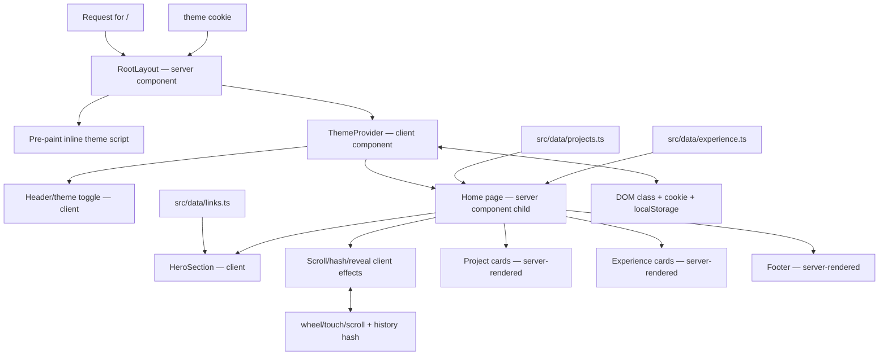
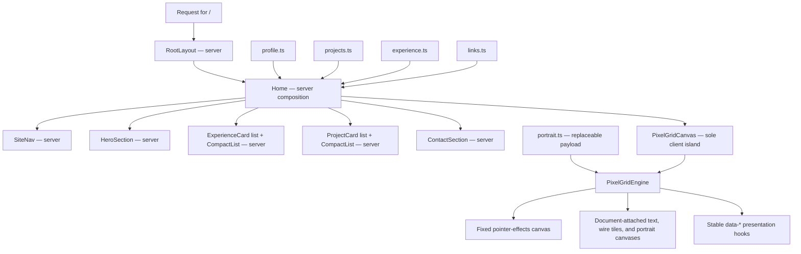

# Website Architecture and Redesign Audit

> Baseline reference for the planned redesign of `amitoj.net`.
>
> Audited: 2026-08-11  
> Repository state: `main` at `cccde00` (also `origin/main` when audited)  
> Live surface checked: `https://amitoj.net/`  
> Production build checked: Next.js 15.5.13, successful
>
> **Document status:** Sections 1–22 preserve the pre-redesign baseline. The
> redesign described in the request was implemented after that audit; section
> 23 records the resulting architecture and verified behavior so future changes
> can distinguish inherited constraints from the new system.

## 1. Executive summary

The current website is a small, single-page portfolio built with the Next.js App Router, React 19, Tailwind CSS 4, TypeScript, and `react-icons`. It has one real page (`/`), seven permanent social redirects, and no backend or external content source.

The architecture is deliberately simple:

- Portfolio content lives in three local TypeScript modules.
- The server maps project and experience arrays directly into HTML/React Server Component output.
- The browser hydrates a small interaction layer for theme selection, hero-to-project scroll snapping, URL hash updates, and fade-in effects.
- No API, database, CMS, client-side data fetch, cache revalidation, loading state, or data error state exists.
- The root layout reads a theme cookie. That one request-time read makes the otherwise-static homepage dynamically server-rendered on every request.

The visual language is coherent but narrow: Montserrat typography, dark-first gray surfaces, violet/blue/cyan gradient text, rounded bordered cards, pill tags, and restrained iconography. The hero is intentionally sparse; the rest of the page reads like a dense résumé.

The largest redesign implications are not visual. They are structural:

1. The site has no content layer beyond handwritten arrays. That is easy to maintain at the current size, but the schemas do not support case studies, project media, structured dates, featured work, filtering, or multiple page types.
2. Scrolling is partly hijacked by a 185-line global gesture controller. It is tightly coupled to the current `home -> projects` geometry and should not be carried into a substantially different layout unchanged.
3. Theme persistence is implemented carefully, but it is responsible for converting the entire route from static output to request-time rendering.
4. The DOM has no `h1` or `h2`; the name and section labels are paragraphs, followed directly by `h3` card titles.
5. Several icon-only controls have weak accessible naming or very small hit areas. The theme button has no accessible name at all.
6. Reveal animations hide most substantive content in CSS until JavaScript runs. Without successful hydration/`IntersectionObserver`, the projects and experience content remains invisible.
7. The mobile hero's seven social icons do not fit comfortably. In a 390 x 844 test viewport, their measured horizontal span ran from `-2.5px` to `377.5px` within a roughly 375px content area, and a horizontal scrollbar was visible.
8. The section-hash observer uses a `0.4` intersection-ratio threshold. On the measured mobile page, the projects and experience sections are too tall ever to reach 40% visibility, so automatic hash updates cannot reliably fire for them.

This document records the current system rather than prescribing a final visual direction. The redesign should treat it as a baseline: preserve the accurate content and useful primitives, then replace the architecture where the new information hierarchy demands it.

## 2. Audit scope and method

The audit included:

- every tracked authored source and configuration file;
- the dependency manifest and resolved lockfile versions;
- route and build output from a fresh optimized production build;
- the live website at desktop and mobile viewports;
- hero navigation, theme switching, and theme persistence;
- rendered section and card geometry;
- server/client component boundaries;
- content flow, browser state, interaction listeners, metadata, PWA assets, and redirects;
- maintainability, accessibility, resilience, and redesign constraints.

The live site was inspected at:

- desktop: 1280 x 720;
- mobile: 390 x 844;
- dark theme and light-theme persistence after reload.

The live content matched the audited repository: seven projects, six experience entries, seven social links, the same ordering, and the current VIU role. This was a focused architecture/design audit, not a full Lighthouse run, assistive-technology session, or exhaustive cross-browser test. Contrast ratios, Core Web Vitals, screen-reader behavior, and real-device touch behavior should still be measured before the redesign ships.

## 3. System at a glance



### Runtime profile

| Concern | Current implementation |
| --- | --- |
| Framework | Next.js App Router 15.5.13 |
| UI runtime | React / React DOM 19.2.4 |
| Language | TypeScript, strict mode |
| Styling | Tailwind CSS 4 plus one global stylesheet |
| Icons | `react-icons` 5.6.0 |
| Package manager | Yarn 4.0.2 with the `node-modules` linker |
| Routes | One page, framework 404, seven permanent redirects |
| Content source | Local TypeScript arrays |
| Data fetching | None |
| Rendering | Dynamic server rendering because `cookies()` is called in the root layout |
| Client state | Theme only |
| Persistent browser state | `theme` cookie and legacy `@app/colorMode` localStorage key |
| Tests | None |
| Lint command/config | None |
| CI/deployment config | None in this repository |
| Analytics/telemetry | None |

## 4. Repository anatomy

```text
.
├── next.config.mjs              Redirects and React strict mode
├── package.json                 Runtime/build dependencies and three scripts
├── postcss.config.mjs           Tailwind 4 PostCSS plugin
├── public/
│   ├── favicon.ico              A 16x16 PNG stored with an .ico extension
│   ├── manifest.json            PWA metadata
│   └── icons/                   PWA icon sizes
├── src/
│   ├── app/
│   │   ├── layout.tsx           Metadata, server theme resolution, app shell
│   │   └── page.tsx             Single-page composition and content mapping
│   ├── components/              Sections, cards, primitives, browser effects
│   ├── data/                    Projects, experience, and social links
│   ├── lib/                     Empty
│   ├── modules/                 Theme context and constants
│   └── styles/globals.css       Tailwind import, dark variant, motion, focus
├── tsconfig.json
└── yarn.lock
```

There are 18 TypeScript/TSX source files. Eight explicitly declare `"use client"`. The codebase is small enough to understand in one sitting, and there is no hidden service or generated content layer.

The README currently only identifies the repository as the source of the portfolio and says more pages will be added. It does not document local setup, the content update workflow, rendering behavior, or deployment.

## 5. Routing and request behavior

### Page routes

| Route | Type | Behavior |
| --- | --- | --- |
| `/` | Dynamic App Router route | Server-rendered portfolio page |
| `/_not-found` | Framework route | Next.js default not-found surface |

There are no nested layouts, route groups, dynamic route parameters, API route handlers, server actions, middleware, rewrites, or custom error/loading files.

### Permanent redirect routes

`next.config.mjs` defines 308 redirects:

| Short route | Destination |
| --- | --- |
| `/github` | GitHub profile |
| `/linkedin` | LinkedIn profile |
| `/twitter` | Twitter profile |
| `/discord` | Discord user profile |
| `/mail` | `mailto:` address |
| `/kofi` | Ko-fi profile |
| `/paypal` | PayPal profile |

The same destinations are duplicated in `src/data/links.ts`. Each social entry contains both `url` and `path`, but the hero renders `url`, not `path`. Consequently:

- the short redirects are available for direct use;
- the live hero bypasses them;
- `SocialLink.path` is currently dead presentation data;
- changing a destination requires remembering two files.

This duplication should be resolved during the redesign. Either the UI should intentionally use first-party short links, or redirects should be derived from/shared with a single serializable link definition.

## 6. Server and client component boundaries

### Render tree

```text
RootLayout [server; dynamic because it reads cookies]
├── <html> + inline pre-paint theme script
└── ThemeProvider [client]
    ├── Header [client]
    │   └── IconButton [client]
    └── Home [server component passed as children]
        ├── ScrollHashUpdater [client; renders null]
        ├── HeroProjectsSnap [client; renders null]
        ├── HeroSection [client]
        │   ├── GradientText [transitive client dependency here]
        │   └── IconLink[] [client]
        ├── Projects section [server]
        │   ├── FadeIn[] [client wrappers]
        │   └── ProjectCard[] [server children]
        ├── Experience section [server]
        │   ├── FadeIn[] [client wrappers]
        │   └── ExperienceCard[] [server children]
        └── Footer [server]
```

An important Next.js nuance: `GradientText.tsx` has no client directive, but `HeroSection` imports it from inside a client boundary. It therefore participates in the client graph for the hero while remaining usable as a server-rendered component when imported by `page.tsx`. Likewise, `src/data/links.ts` and its icon component references enter the hero's client bundle.

`ThemeProvider` is a client boundary around the page, but server-rendered `children` can still be passed through it. This does not automatically convert every card into a client component. Project and experience cards remain server-produced markup, with `FadeIn` providing a hydrated wrapper around their output.

### Component responsibilities

| Component | Boundary | Responsibility | State/side effects | Redesign note |
| --- | --- | --- | --- | --- |
| `RootLayout` | Server | Metadata, font, initial theme, shell | Reads request cookie | This cookie read makes `/` dynamic |
| `Home` | Server | Page/section composition | None | Owns all information architecture |
| `ThemeProvider` | Client | Theme context and persistence | React state, cookie, localStorage, root class | Useful behavior; overly high-level for one consumer |
| `Header` | Client | Fixed theme toggle | Reads theme context | It is a `div`, not a semantic `header` |
| `HeroSection` | Client | Name, social row, down arrow | Scroll listener and arrow visibility state | Entire hero hydrates for one scroll-derived boolean |
| `HeroProjectsSnap` | Client | Hero/projects gesture interception | Five global listeners, timers, mutable closure state | Most coupled and fragile interaction module |
| `ScrollHashUpdater` | Client | Reflect visible section in URL hash | One `IntersectionObserver`, history writes | Threshold fails for very tall sections |
| `FadeIn` | Client | Reveal children on intersection | Observer and delayed class mutation | Content starts hidden and depends on JS |
| `ProjectCard` | Server | Project summary, links, tags | None | Good content/presentation seam, schema is limited |
| `ExperienceCard` | Server | Role summary and links | None | Duplicates much of project-card shell |
| `GradientText` | Server/client by import graph | Gradient text styling | None | Always renders a paragraph; cannot express heading semantics |
| `IconLink` | Client | Social icon anchor | None | Does not need client behavior by itself |
| `IconButton` | Client | Theme-aware icon button | Reads theme context | Generic abstraction is tightly theme-coupled |
| `Footer` | Server | Copyright year | Reads server clock at render | Minimal and non-navigational |

## 7. Data loading and content flow

### Initial request sequence

1. A request reaches the App Router root layout.
2. `RootLayout` calls `cookies()` and reads `theme`.
3. Missing, invalid, or non-`light` cookie values resolve to dark mode.
4. `Home` imports `projects` and `experiences` synchronously from local modules.
5. The server maps those arrays into project and experience card output.
6. The hero's social definitions are part of the client import graph because `HeroSection` is a client component.
7. Next.js sends the server-rendered document/RSC payload plus JavaScript needed for the client boundaries.
8. Before the body paints, an inline script reconciles the root `dark` class from the cookie or legacy localStorage value.
9. React hydrates the theme, hero, scroll, hash, and reveal components.
10. Intersection observers reveal section headings and cards as they enter the viewport.

There is no asynchronous portfolio-data operation in this sequence. No suspense boundary waits for content. No data request can independently fail. All content changes require editing code, committing it, rebuilding the application, and deploying it.

### Content sources

| Source | Count | Consumer | Shape |
| --- | ---: | --- | --- |
| `src/data/projects.ts` | 7 | `Home -> ProjectCard` | name, year, bullets, tech, optional GitHub/site |
| `src/data/experience.ts` | 6 | `Home -> ExperienceCard` | role, company, location, period, bullets, optional site/GitHub/Instagram |
| `src/data/links.ts` | 7 | `HeroSection -> IconLink` | name, direct URL, short path, description, React icon component |

### What the current content model does well

- Types sit next to the data and are enforced by the production type check.
- Content is version-controlled and reviewable.
- Rendering has no remote dependency or client waterfall.
- The schemas match the current card layouts and keep the component props simple.
- Optional links avoid empty controls.

### Limits of the current content model

- Projects have no stable ID or slug beyond the display name.
- Experience entries are keyed by a concatenated company/role assumption.
- Dates are display strings, so they cannot be reliably sorted, filtered, localized, or used for duration calculations.
- Project years are numbers but the array is manually ordered and currently non-chronological (`2026, 2022, 2024, 2024, 2025, 2024, 2022`).
- Experience order is also editorial/manual rather than strictly chronological.
- Bullet list items use array indexes as React keys.
- There is no `featured`, `status`, `role`, `summary`, `impact`, `media`, `thumbnail`, `repository status`, `caseStudy`, `client`, `category`, or structured link list.
- Link fields are provider-specific (`github`, `instagram`, `link`) instead of a reusable links collection.
- `SocialLink.icon` is a React component. That couples content to rendering and prevents the object from being clean JSON or CMS data.
- There is no runtime validation. TypeScript protects authored code at compile time but would not validate future CMS/API payloads.
- There is no draft/publish workflow or preview state.

For a redesign with case-study pages or a CMS, first normalize this data into pure serializable records. Resolve icon names to components in the presentation layer.

## 8. Theme architecture

Theme has three coordinated layers:

1. **Server decision:** `RootLayout` reads the `theme` cookie and applies or omits the `dark` class on `<html>`.
2. **Pre-paint correction:** an inline `<head>` script checks the same cookie, falls back to `@app/colorMode` in localStorage, and corrects the class before body paint.
3. **Hydrated state:** `ThemeProvider` holds `colorMode`, updates the root class, writes a one-year `SameSite=Lax` cookie, and mirrors the selection into localStorage.

### Theme resolution matrix

| Cookie | Legacy localStorage | Server HTML | Pre-paint result | Hydrated result |
| --- | --- | --- | --- | --- |
| `light` | any | light | light | light |
| `dark` | any | dark | dark | dark |
| missing | `light` | dark | light | migrates to light cookie/state |
| missing | `dark` | dark | dark | migrates to dark cookie/state |
| missing | missing/invalid | dark | dark | dark |

The approach prioritizes stable initial visuals and backwards compatibility. Live testing confirmed that switching to light mode persisted across a reload.

### Theme tradeoffs and debt

- Calling `cookies()` makes the homepage dynamic even though its content is static.
- Default mode is always dark. `prefers-color-scheme` and a three-state `system` option are not used.
- The inline script duplicates string literals and resolution logic from the TypeScript module; these can drift.
- `suppressHydrationWarning` is applied to `<html>` to tolerate class differences.
- An inline `dangerouslySetInnerHTML` script complicates a future strict Content Security Policy unless a hash or nonce is provided.
- `ThemeProvider` wraps the full page even though only the header control currently consumes its context.
- The toggle button's icon changes correctly, but the button has no `aria-label` or non-empty `title`.
- The visual hit area is about 20 x 20 pixels (24px high after live rendering), below common touch-target guidance.
- A 500ms body color transition is always enabled, including for users who request reduced motion.

### Redesign decision

Choose explicitly between:

- **Static route:** resolve theme entirely in a small pre-paint/client mechanism, allowing the content page to be pre-rendered and cached; or
- **Request-aware theme:** keep cookie-driven server HTML and accept dynamic rendering because perfect first-response theme fidelity is a product requirement.

Neither is universally correct. The current site pays the dynamic-rendering cost for theme fidelity.

## 9. Scroll, navigation, and URL state

The page has three section IDs: `home`, `projects`, and `experience`.

### Native/CSS layer

- `<html>` has `scroll-behavior: smooth`.
- `<html>` receives Tailwind's `snap-y snap-proximity` classes.
- Only the experience section has `snap-start`.
- The hero arrow is a native anchor to `#projects`.

Because home and projects have no snap alignment class, CSS scroll snapping is not the main hero/projects mechanism. That behavior comes from JavaScript.

### `HeroProjectsSnap`

This component renders nothing and registers global listeners for:

- `wheel` (non-passive);
- `touchstart`;
- `touchmove` (non-passive);
- `touchend`;
- `scroll`.

It computes the projects section's `offsetTop`, treats the space between `0` and that offset as a forbidden zone, and calls smooth `window.scrollTo` to force either the hero top or projects top.

Its internal behavior depends on:

- a mutable `isAnimating` flag;
- a mutable `gestureComplete` flag;
- a 400ms scroll-idle timer;
- a fixed 900ms animation timer;
- touch delta greater than 20px;
- a narrow `projectsTop +/- 5px` mobile boundary;
- a `projectsTop + 15px` desktop boundary;
- a 100ms fallback snap timer.

### Consequences

- The module assumes projects directly follows a full-viewport hero.
- Adding an announcement bar, different hero height, sticky navigation, intro section, or conditional block changes its geometry and behavior.
- It intercepts native wheel/touch gestures and can feel like the page is resisting the user.
- Fixed timer durations assume the browser's smooth-scroll timing.
- Touch move is prevented throughout the hero zone, which can interfere with expected overscroll behavior.
- Keyboard scrolling is not handled in the same controlled model.
- Reduced-motion preferences do not disable smooth snapping.
- Multiple local timers and flags approximate a state machine without making its states explicit.
- Global listeners make the behavior page-wide even though the desired effect concerns one transition.

The redesign should start with native document flow, anchor links, and `scroll-margin`. Add limited CSS snap behavior only if user testing supports it. A large global gesture interceptor should be a last resort.

### `ScrollHashUpdater`

An `IntersectionObserver` watches all three sections at threshold `0.4`. When an entry intersects, it uses `history.replaceState` to set:

- no hash for home;
- `#projects` for projects;
- `#experience` for experience.

This has a geometry bug for tall sections. Intersection ratio is the visible target area divided by the target's full area. In the measured mobile layout:

| Section | Height | Viewport height | Maximum possible visible ratio |
| --- | ---: | ---: | ---: |
| Projects | 2835px | 844px | ~0.298 |
| Experience | 2729px | 844px | ~0.309 |

Neither can reach the configured 0.4 threshold. The anchor click sets `#projects` itself, but observer-driven hash updates during ordinary mobile scrolling are not reliable. On desktop, the measured ratios are only slightly above the threshold, making the behavior sensitive to viewport and content changes.

A redesign should derive section state from viewport-position/root margins or observe small sentinels/headings rather than using a percentage of an arbitrarily tall section.

## 10. Styling and design system

### Styling stack

- Tailwind CSS 4 is loaded through `@tailwindcss/postcss`.
- There is no `tailwind.config` file.
- A custom dark variant applies styles under `.dark`.
- Most styling is inline utility strings in components.
- `globals.css` contains only document sizing, smooth scrolling, two animations, reveal classes, and a global focus-visible rule.

### Current visual tokens (implicit, not formalized)

| Category | Current vocabulary |
| --- | --- |
| Page background | white / `gray-900` dark |
| Card surface | `gray-50` / translucent `gray-800` dark |
| Borders | `gray-200`, dark `gray-700/50`, stronger hover borders |
| Primary accent | violet -> blue -> cyan gradients |
| Body text | gray-600 / gray-400 |
| Muted text | gray-500 / gray-400 |
| Tags | violet tint with violet text |
| Typeface | Montserrat from `next/font/google` |
| Content width | `max-w-5xl` (1024px at the tested desktop size) |
| Section gutter | 24px (`px-6`) |
| Card radius | `rounded-xl` |
| Card padding | 24px (`p-6`) |
| Motion | 300-600ms transitions, hover lift, glow, bounce, reveal |

There are no named CSS variables or theme tokens for color, type scale, spacing, radii, elevation, motion duration, or content widths. The visual system exists as repeated class strings.

### Duplication and coupling

- `ProjectCard` and `ExperienceCard` repeat the same outer card classes.
- They repeat link icon styling and list/bullet treatment.
- A gradient class constant is duplicated in both card files instead of using `GradientText` or a token.
- `GradientText` always emits a paragraph, adds `p-1`, and accepts arbitrary string sizes despite a long nominal type union.
- `IconButton` is presented as a generic primitive but directly consumes theme context and applies theme-specific glow styling.
- `IconLink` declares `"use client"` despite having no state, effect, handler, or browser-only API.

For the redesign, build a small intentional primitive layer only after the visual direction is known: semantic heading/text variants, a link/icon-control primitive with proper target size, card/surface tokens, a section/container primitive, and design tokens expressed as CSS variables or a clearly centralized Tailwind theme.

## 11. Rendered information architecture

The live page is linear:

1. Full-viewport hero
   - name;
   - seven social/payment/contact icons;
   - down arrow;
   - fixed top-right theme toggle.
2. Projects
   - seven full-width stacked cards.
3. Experience
   - six full-width stacked cards.
4. Copyright-only footer.

There is no visible navigation, introduction, role/tagline, portrait, biography, skills summary, availability/status, primary call to action, résumé link, project imagery, testimonials, education section, writing, or case-study route.

The hero communicates identity but not positioning. A visitor can see the name and external profiles, but must scroll before learning what kind of work Amitoj does. The projects/experience sections contain strong technical detail, but every entry receives nearly equal visual weight.

That creates a distinct density shift:

- hero: extremely sparse and atmospheric;
- body: dense résumé cards with long bullets and many tags;
- footer: minimal closure.

The redesign should decide whether the primary goal is hiring, consulting, project discovery, personal identity, or community/support. That goal should determine the hero message, primary CTA, project hierarchy, and which social/payment links deserve first-screen prominence.

## 12. Live layout observations

### Desktop: 1280 x 720

| Surface | Measured result |
| --- | ---: |
| Document height | 4101px |
| Hero | 1265 x 720px |
| Projects section | 1024 x 1738.75px |
| Experience section | 1024 x 1558.25px |
| Project top | 720px |
| First project card | 224.25px tall |
| Second project card | 245px tall |
| First-load project snap | landed exactly at `scrollY = 720`, hash `#projects` |

The desktop hero is visually balanced: the name is centered, the social row has generous spacing, the theme control is unobtrusive, and the down arrow clearly implies more content. Project cards use the width effectively and show two to three cards per viewport depending on content.

The main desktop weakness is communication hierarchy. The hero does not say “software engineer,” explain specialties, or offer a primary action. All seven social/contact/support destinations are represented equally by unlabeled icons.

### Mobile: 390 x 844

| Surface | Measured result |
| --- | ---: |
| Document height | 6492px |
| Hero | 375 x 844px layout box |
| Projects section | 375 x 2835px |
| Experience section | 375 x 2729px |
| Name | ~334px wide, 48px font size |
| First project card | 327 x 464.25px |
| Second project card | 327 x 464.25px |
| Theme control | about 20 x 20px visual box |
| First project GitHub control | 20 x 20px |

The name fits at the tested width and the stacked cards remain readable. Tags wrap as expected. The hero social row does not fit robustly: its first measured icon began at `-2.5px` and its last ended at `377.5px`, with a horizontal scrollbar visible in the tested rendering. The row uses fixed `space-x-10` spacing and has no wrapping or responsive reduction.

The body becomes very long (about 6.5k pixels), but the page supplies no persistent navigation or “back to top” affordance. The custom hero snap makes the first transition feel intentional, while the rest of the document is ordinary long-form scrolling.

### Theme behavior

Dark is the default for a new/no-cookie visit. The light toggle changed the root class and body background correctly, and the selected mode remained light after reload in the live test.

## 13. Accessibility, semantics, and resilience

### Positive foundations

- The root document declares `lang="en"`.
- Project and experience details use real unordered lists.
- External links opened in new tabs from cards use `rel="noopener noreferrer"`.
- The down arrow has an `aria-label`.
- Social icon links received accessible names in the inspected accessibility tree from their title/icon metadata.
- A global `:focus-visible` outline is present.
- Text/background dark variants are consistently provided.
- Content is server-rendered rather than injected only after a data fetch.

### Findings to fix before or during redesign

| Priority | Finding | Impact |
| --- | --- | --- |
| High | No `h1` or `h2`; name and section titles are paragraphs; cards begin at `h3` | Broken document outline and weaker screen-reader/SEO structure |
| High | Theme toggle has no accessible name | Screen-reader users encounter an unnamed button |
| High | Reveal CSS sets content to opacity 0 until JS/observer success | Most portfolio content disappears if hydration or observer setup fails |
| High | Global wheel/touch interception overrides native scrolling | Can create motor, vestibular, and interaction-predictability barriers |
| High | No `prefers-reduced-motion` behavior | Bounce, smooth scroll, reveals, hover growth, and theme transitions remain active |
| Medium | Icon controls are around 20px rather than ~44px touch targets | Difficult mobile targeting |
| Medium | Mobile social row exceeds usable width | Clipped/edge controls and horizontal scrolling |
| Medium | Social destinations rely on icons with no persistent text labels | Recognition depends on brand-icon familiarity |
| Medium | Hash observer cannot reach threshold for tall mobile sections | URL state does not consistently reflect position |
| Medium | Header is a `div`, and there is no navigation landmark | Page structure is less discoverable to assistive technology |
| Medium | Gradient text uses transparent fill/background clipping | Needs explicit forced-colors/high-contrast verification |
| Low | Hover icon growth changes geometry from 20px to 30px | Can cause jitter and is not useful on touch |
| Low | Empty `title` is passed through the theme button/icon | Adds no fallback semantics |

The global focus style is a useful baseline, but a redesign needs a deliberate accessibility pass covering heading order, landmark structure, control labels, keyboard navigation, touch targets, reduced motion, forced colors, zoom/reflow, and measured color contrast.

### JavaScript failure mode

Every projects/experience heading and card is wrapped in `.fade-in`, whose initial CSS is:

```css
opacity: 0;
transform: translateY(20px);
```

Only the client `IntersectionObserver` adds `.fade-in-visible`. A more resilient pattern starts content visible and applies pre-animation styles only after the browser confirms that animation can run, or uses CSS view timelines/progressive enhancement with a reduced-motion fallback.

## 14. Performance and delivery characteristics

Fresh optimized build output:

```text
Route (app)                    Size     First Load JS
ƒ /                           6.59 kB  109 kB
ƒ /_not-found                 995 B    103 kB
Shared by all                          102 kB
```

The build classifies `/` as dynamic and server-rendered on demand. The reason is the root `cookies()` call, not content fetching.

### Efficient aspects

- There is no client-side content fetch or render waterfall.
- Project and experience markup is server-produced.
- There are no portfolio screenshots, video, canvas effects, or large hero images.
- `next/font` self-hosts the compiled font output at runtime.
- The page has only one route and a modest first-load bundle.
- No analytics or third-party runtime scripts are present.

### Costs and risks

- A theme preference prevents static generation/full-page CDN caching.
- Eight explicit client modules hydrate, and transitive imports add to the client graph.
- `HeroProjectsSnap` registers five global listeners, including non-passive wheel/touch listeners.
- `HeroSection` registers another scroll listener solely to toggle arrow visibility.
- `ScrollHashUpdater` and every `FadeIn` instance add observers.
- All 13 long-form cards are rendered up front. This is acceptable now but will not scale indefinitely if content expands.
- `react-icons` is convenient, but the redesign should verify actual chunk composition if many more icon sets are introduced.
- The Montserrat build depends on reaching Google Fonts during compilation. The first sandboxed build failed at `fonts.googleapis.com`; with network access, the build succeeded. A vendored local font would remove that build-time network dependency.
- No bundle analyzer, Web Vitals reporting, performance budget, or automated Lighthouse check exists.

The current 109 kB first-load JavaScript is not an emergency. The best performance win during redesign is architectural: retain server-rendered content, remove gesture/reveal JavaScript that does not materially improve the experience, and decide whether request-time theme rendering is worth losing a static route.

## 15. SEO, metadata, redirects, and PWA surface

### Current metadata

`RootLayout` provides:

- title: `Amitoj Singh`;
- description: `Amitoj's Portfolio`;
- manifest link;
- favicon;
- Open Graph title/description;
- an absolute GitHub avatar URL as the Open Graph image.

### Gaps

- The description is generic and communicates no discipline, specialty, or location.
- The rendered page has no semantic `h1`.
- There is no canonical URL declaration.
- There is no Twitter/X card configuration.
- There is no dedicated branded social-share image.
- There is no sitemap or robots configuration.
- There is no structured data (`Person`, `ProfilePage`, `WebSite`, or project/work entities).
- Project entries have no individual URLs, titles, or metadata surfaces.

### Manifest/PWA observations

- The manifest names the portfolio, uses dark gray theme/background colors, and starts at `/`.
- `display` is `fullscreen`, which is unusually restrictive for a portfolio.
- `orientation` is forced to `portrait`, which is not a good default for a general website/PWA.
- There is no service worker or offline behavior, so this is install metadata rather than a complete PWA strategy.
- The manifest references `icons/icon-72x72.png`, but the tracked file is named `icon-72x72.png.png`. That 72px asset reference is broken in the repository output.
- `favicon.ico` is actually PNG data in a file with an `.ico` extension. Browsers often tolerate this, but it should be normalized.

The redesign should decide whether installability is a real product goal. If not, simplify the manifest surface. If it is, provide correct maskable icons, sensible display/orientation behavior, and an explicit offline/update strategy.

## 16. Security and privacy posture

The current site has a small attack/privacy surface:

- no forms;
- no authentication;
- no user-generated content;
- no database;
- no API endpoints;
- no analytics;
- no ad/marketing pixels;
- no remote runtime content feed;
- one non-sensitive theme cookie.

External project/experience links that open new tabs correctly include `noopener noreferrer`. Hero social links navigate the same tab and therefore do not need opener protection, though the inconsistent navigation behavior should be an intentional redesign choice.

No security headers are configured in `next.config.mjs`. A future strict Content Security Policy must account for the inline theme script or replace it with a nonce/hash-compatible approach. If the redesign adds analytics, contact forms, a CMS, embeds, or remote media, revisit CSP, privacy disclosure, spam protection, validation, and data retention at that time.

## 17. Code quality and maintainability

### Strengths

- `strict: true` TypeScript.
- Production build performs type validation successfully.
- React strict mode is enabled.
- Components are short and generally single-purpose.
- Data interfaces make current authoring straightforward.
- Server components are used for non-interactive cards.
- Aliased imports (`@/*`) reduce fragile relative paths.
- Dark/light styles are consistently paired.

### Debt and missing guardrails

- No test files or test runner.
- No lint script or ESLint configuration.
- No formatting configuration.
- No CI workflow.
- No component workshop/story environment.
- No visual regression or responsive tests.
- No automated accessibility check.
- No documented content-editing workflow.
- No documented deployment target/configuration.
- `allowJs: true` is enabled despite authored source being TypeScript.
- `skipLibCheck: true` trades dependency type coverage for faster builds.
- `src/lib` exists but is empty.
- Reusable appearance is duplicated across cards and link controls.
- Some client directives are broader than required.
- Interaction code uses timers and mutable flags without tests.
- Recent content ordering is manual and inconsistent rather than encoded by a rule.

### Specific implementation seams

1. **Card shell:** extract only after deciding whether projects and jobs should continue sharing a visual surface.
2. **External icon link:** centralize accessible naming, `target` behavior, focus styling, and touch area.
3. **Section heading:** replace gradient paragraph styling with a polymorphic/semantic heading pattern.
4. **Content records:** separate pure content from React icon imports.
5. **Theme bootstrap:** centralize constants and resolution rules.
6. **Scroll behavior:** replace global interception with progressive enhancement.
7. **Motion:** centralize durations/easings and respect reduced-motion preference.

## 18. Redesign constraints and opportunities

### Preserve unless product direction changes

- Accurate project and experience copy.
- Version-controlled content as an option; a CMS is not automatically necessary.
- Server-rendered portfolio content.
- Strong dark/light parity.
- Short social redirects if they are used intentionally.
- Clear project technologies and outcome-oriented bullets.
- Simple external-link security behavior.
- The recognizable violet/blue/cyan accent, if it remains part of the desired identity.

### Reconsider early

- What one action should a first-time visitor take?
- Is the audience primarily employers, clients, collaborators, users of Amitoj's projects, or all of them?
- Should project case studies have their own routes?
- Which two or three projects deserve primary visual weight?
- Should experience be a timeline, résumé download, or secondary page rather than thirteen equal cards in one long document?
- Are Ko-fi and PayPal primary portfolio navigation items or lower-priority footer links?
- Does the site need a CMS, or would validated Markdown/MDX/TypeScript content remain simpler?
- Is theme selection important enough to make every request dynamic?
- Is installable-PWA behavior a real requirement?
- How much motion fits the identity without taking control away from scrolling?

## 19. Recommended target architecture

This is a scalable default, not a mandatory file tree:

```text
src/
├── app/
│   ├── layout.tsx
│   ├── page.tsx
│   ├── projects/[slug]/page.tsx       optional case studies
│   ├── sitemap.ts
│   └── robots.ts
├── components/
│   ├── ui/                            semantic primitives
│   ├── layout/                        header, footer, container, section
│   └── sections/                      hero, featured work, experience, contact
├── content/
│   ├── projects/                      pure serializable records or MDX
│   ├── experience.ts
│   └── social-links.ts
├── lib/
│   ├── content.ts                     validation/loading/sorting
│   └── metadata.ts
└── styles/
    └── globals.css                    tokens, base rules, reduced motion
```

### Target content record principles

- stable `id` and optional `slug`;
- structured start/end dates plus display overrides;
- explicit sort order or deterministic sorting;
- short summary separate from proof/impact bullets;
- generic links array (`label`, `href`, `kind`);
- media with alt text and dimensions;
- `featured`/priority fields;
- pure JSON-compatible values;
- schema validation (for example, Zod) if content moves out of TypeScript;
- draft/published state only if a publishing workflow requires it.

### Target rendering principles

- Keep the landing page and case studies server-rendered.
- Isolate client components to controls that truly need browser state.
- Prefer static generation for stable content unless request-time personalization is valuable.
- Treat motion as progressive enhancement.
- Never make core content visibility depend on JavaScript.
- Use native anchors and document flow as the default navigation model.
- Use real headings and landmarks from the first implementation pass.
- Keep link/control target areas large enough for touch.
- Give every major content object a stable URL if it merits sharing or search visibility.

### Target design-system principles

- Define semantic tokens (`background`, `surface`, `text`, `muted`, `accent`, `border`) rather than scattering palette values.
- Define a restrained type scale with semantic heading components.
- Define container widths and spacing rhythm once.
- Define motion duration/easing tokens and reduced-motion alternatives.
- Separate brand expression from content semantics: a heading can use a gradient without becoming a paragraph.
- Design icon controls with visible or programmatic labels and consistent hit boxes.

## 20. Suggested redesign sequence

### Phase 0 — Freeze the baseline

- Preserve this audit and current screenshots/build metrics.
- Confirm the project/experience copy and intended ordering.
- Identify the primary audience and conversion goal.
- Decide which existing links/content must survive URL changes.

### Phase 1 — Normalize content

- Introduce stable IDs/slugs and structured dates.
- Decouple icon components from data.
- Add explicit featured/sort fields.
- Decide TypeScript vs Markdown/MDX vs CMS based on actual authoring needs.
- Add validation if content can arrive from outside the compiler.

### Phase 2 — Establish accessible foundations

- Create semantic page landmarks and heading order.
- Build container, section, typography, link, and icon-control primitives.
- Add design tokens for both themes.
- Implement reduced-motion behavior.
- Make all content visible without JavaScript.

### Phase 3 — Build the new information architecture

- Implement the new hero message and primary CTA.
- Add featured-work hierarchy.
- Add case-study routes if selected.
- Reframe experience and contact/footer content.
- Move lower-priority social/payment destinations out of the primary hero if appropriate.

### Phase 4 — Add interactions carefully

- Start with native scrolling and anchors.
- Add motion only where it clarifies hierarchy or feedback.
- Keep section/hash navigation based on headings/sentinels rather than section ratios.
- Test keyboard, touch, reduced-motion, zoom, and direct hash navigation.

### Phase 5 — Finish delivery surfaces

- Improve title/description and add canonical/social metadata.
- Produce a dedicated social-share image.
- Add sitemap, robots, and structured data where useful.
- Fix or remove the PWA manifest/assets.
- Decide and document theme-rendering/cache strategy.
- Add deployment and content-update documentation.

### Phase 6 — Add quality gates

- Lint and formatting commands.
- Unit tests for content sorting/validation and theme resolution.
- Interaction tests for navigation/theme.
- Automated accessibility smoke test.
- Responsive visual regression at representative widths.
- Production build in CI.
- Performance budget and a measured Lighthouse/Web Vitals baseline.

## 21. Verification checklist for the redesign

### Content and routes

- [ ] Every current project, role, and required external link is accounted for.
- [ ] Redirects remain valid or have an intentional migration plan.
- [ ] Direct links and refreshes work for every new page/hash.
- [ ] Dates/order come from explicit structured rules.

### Rendering and data

- [ ] Core content appears in server HTML.
- [ ] No unnecessary client-side data waterfall exists.
- [ ] Loading/error states exist for any newly introduced remote source.
- [ ] Cache/revalidation behavior is documented.
- [ ] Client boundaries are deliberate and measured.

### Accessibility

- [ ] Exactly one clear `h1`; logical `h2`/`h3` hierarchy.
- [ ] `header`, `nav`, `main`, and `footer` landmarks are present as appropriate.
- [ ] All icon-only controls have accessible names and adequate hit areas.
- [ ] Keyboard order and focus visibility are verified.
- [ ] Reduced-motion mode disables nonessential movement and forced smooth scrolling.
- [ ] Content remains visible and usable when JavaScript fails.
- [ ] 200%/400% zoom and narrow-width reflow do not introduce horizontal scrolling.
- [ ] Color contrast and forced-color behavior are measured.

### Responsive/interaction

- [ ] 320, 375/390, 768, 1024, 1280, and wide desktop layouts are checked.
- [ ] Real touch scrolling remains native and predictable.
- [ ] Navigation accounts for any sticky header with `scroll-margin`.
- [ ] No section state depends on impossible intersection ratios.
- [ ] Hover-only affordances have touch/keyboard equivalents.

### Performance and SEO

- [ ] First-load JavaScript is compared against the 109 kB baseline.
- [ ] Route static/dynamic status is intentional.
- [ ] Font loading does not create an avoidable build/runtime dependency.
- [ ] Images declare dimensions and use appropriate formats.
- [ ] Metadata, canonical URL, share image, sitemap, and robots are complete.
- [ ] Structured data matches visible claims.

## 22. Known facts vs. open decisions

### Known facts

- The current site is one dynamically server-rendered page.
- Portfolio content is entirely local and synchronous.
- The build passes type checks.
- There are no tests, lint config, APIs, analytics, CMS, or deployment config in the repo.
- The live site matches the audited content.
- Theme persistence works.
- The mobile social row overflows its comfortable layout bounds.
- The current hash threshold cannot work for the measured tall mobile sections.
- The PWA 72px icon filename does not match the manifest.

### Product/design decisions still needed

- Audience and primary CTA.
- One-page vs. multi-page/case-study information architecture.
- Content authoring system.
- Featured-project hierarchy.
- Brand direction, typography, and motion character.
- Theme modes and server/static strategy.
- PWA requirement.
- Analytics/contact-form requirements.
- Deployment platform and preview workflow.

Those decisions should be made before extracting a large generic component library. The present code is small; the redesign can afford to shape components around a clear content and visual system instead of preserving abstractions that only fit the current page.

## 23. Implemented pixel-grid redesign

### Resulting architecture

The redesign retains the useful part of the original architecture—local typed
content mapped directly into server-rendered components—while replacing the
theme and scroll controller with one isolated visual engine.



The semantic headings, paragraphs, lists, and links remain real HTML. The
canvas is an `aria-hidden` enhancement and does not own content. Until the
engine has loaded the local font and measured the display type, the DOM text
remains visible. Each heading receives `data-pixel-text` only after its own
canvas succeeds. Its canvas is positioned inside the semantic heading, so the
browser scrolls both together without waiting for JavaScript. The background
grid is document-attached CSS; the fixed canvas only paints pointer effects.

### Component responsibilities

| Component/module | Runtime | Responsibility |
|---|---|---|
| `app/layout.tsx` | Server | Existing metadata/manifest/favicon contract and local variable font |
| `app/page.tsx` | Server | Section composition and mapping local content arrays |
| `SiteNav` | Server | Fixed numbered anchor navigation |
| `HeroSection` | Server | Availability and current-role status, identity, bio, stats, and featured links |
| `SectionHeading` | Server | Numbered semantic `h2` primitive |
| `ProjectCard` | Server | Project timeline node, project narrative, technologies, and CTA |
| `ExperienceCard` | Server | Employment metadata, role, links, and retained bullet content |
| `CompactList` | Server | One-row entries for secondary roles and projects; only the title links out, so hover paint stays label-sized |
| `ContactSection` | Server | Data-driven contact copy, portrait host, social/direct links, and footer |
| `PixelGridCanvas` | Client | Explicit visual configuration and engine lifetime only |
| `PixelGridEngine` | Browser JS | Local raster caches, pointer paint, reveals, tiled wire, portrait lifetime, and scroll progress |
| `portraitRenderer.js` | Browser JS, lazy-loaded | Cancellable portrait processing in bounded tasks; shared decoded source cache |
| `portrait.ts` | Shared data | 320×299 encoded luminance mask; replaceable without editing a component |

The old theme provider/toggle, hero snap controller, hash updater, generic
fade-in component, and icon wrappers were removed. They either conflicted with
the reference interaction model or existed only to support the retired theme
system.

### Styling contract

Component styling must be authored with Tailwind utilities directly in each
component's `className`. Layout, spacing, sizing, typography, color,
responsive behavior, and interaction states belong beside the markup they
style. Do not introduce semantic/BEM class names and implement them in
`globals.css`, and do not use `@apply` to recreate a parallel component-class
system.

`src/styles/globals.css` is intentionally limited to concerns that are truly
document-wide or cannot live on one element:

- the Tailwind import;
- shared CSS custom properties used by both Tailwind utilities and the canvas
  engine;
- base document, selection, and focus-visible behavior;
- shared keyframe definitions;
- the per-element `[data-pixel-text]` handoff and engine-generated canvas placement;
- reduced-motion and forced-colors fallbacks.

Stable `data-*` attributes are reserved for `PixelGridEngine` measurement and
rendering hooks. They are not an alternative styling class system. Responsive
variants and arbitrary values should remain inline as Tailwind utilities so a
component's visual behavior can be understood without searching a global
stylesheet.

Typography must use Tailwind's named, relative type scale (`text-xs` through
`text-9xl`) and standard breakpoint variants such as `sm:`, `md:`, `lg:`, and
`xl:`. Do not size type with pixel-valued arbitrary utilities, viewport math,
or `clamp()`. Prefer the closest named Tailwind size and move to the next named
step at a standard breakpoint.

### Authoritative visual configuration

The client island passes every behavior explicitly rather than relying on
bundle/runtime fallbacks:

| Setting | Implemented value |
|---|---|
| Hero | At least full-viewport, centered, two-line identity; grows instead of clipping on short screens |
| Render scope | Display type only |
| Desktop cell | 4px with 0.5px gap |
| Narrow cell | 3px with 0.5px gap below 760px |
| Type-in | 480ms on fine pointers; immediate on touch/reduced motion |
| Project wire | Cells |
| Palette | Violet |
| Accent | `#8B5CF6` |
| Brush | Radial + dither |
| Radius | 3 cells; contracts over links and expands over portrait |
| Paint fade | 500ms |
| Accumulate | Off |
| Click paint | Off |
| Portrait | Faint; heats on hover; touched portrait cells persist for the session |
| Scrolling | Native on every device; no transformed wrapper or synthetic easing |
| Content reveals | Brief opacity fade on fine pointers; immediate on touch/reduced motion |
| Ambient cues | Three introductory cycles, then static |

Pointer paint is event-driven. It stamps a radial/dither field at the current
pointer position, then lets those cells decay; it does not interpolate a comet
trail between distant pointer events. Link cells animate on a deterministic
120ms cadence. Bordered buttons clip the animation to the control box and paint
every cell with a shade from the violet ramp; bare links retain a dithered
falloff around their text. Hovered link and button labels use weight 700 for
legibility; the bare-link bloom extends three cells horizontally and one cell
vertically beyond the label.

The project trace is snapped to the responsive DOM rail. Its inactive portion
uses a denser four-of-six faint-cell pattern. Each project node is a symmetric
5×5 grid square centered on the trace, and its horizontal branch occupies the
node's exact middle row. The wire head is positioned at 55% of the viewport,
while node activation begins earlier at the reference's 62% threshold. The node
activates one column at a time from left to right at 32ms per column; only after
all five columns fill does its centered branch advance over 220ms. Scrolling back above
the node plays the sequence in reverse: the branch retracts first, followed by
the node clearing one column at a time from right to left. When scrolling
advances the wire, the head
brightens and emits a deterministic three-cell-radius spray that changes every
90ms while scrolling, then settles. Touch and reduced-motion modes omit the
spray and node transitions. The wire uses narrow 128-row canvas tiles attached
to the track, avoiding mobile canvas size limits and positional scroll lag.
Settled content does not keep requesting frames. The Page Visibility API pauses
animation while the document is hidden. Motion-preference changes apply live.

### Portrait and font assets

The portrait is not a bitmap checked into a component. `portrait.ts` contains a
95,680-character custom-base64 luminance mask with 320 columns, 299 rows, and a
0.38 tonal pivot. All 95,680 samples are present, including 58,033 nonzero
samples. The engine follows the reference pipeline exactly: `(code - 1) / 62`
luminance decoding, area-averaged resampling with a 50% occupancy mask, 5×5
blur, 0.55 unsharp contrast, pivot-based tonal remapping, four-level
quantization, and masked Floyd–Steinberg diffusion. Portrait cells also retain
the reference-specific 2px gap at a 6px cell size, with proportionally smaller
gaps when the portrait grid is subdivided on narrow screens.

The contact host reserves its final 320:299 aspect ratio on every viewport.
Portrait loading begins within two viewports of the section; decoding,
resampling, blur, diffusion, and painting yield in short tasks. Resizing or
unmounting cancels unfinished work. Completed source decoding is retained, and
height-only viewport changes retain text and portrait rasters.

JetBrains Mono's Latin variable WOFF2 is stored locally in
`public/fonts/jetbrains-mono-latin.woff2`. This removes the Google Fonts build
dependency and ensures that CSS layout and canvas text measurement use the
same stable asset.

### Delivery and SEO after implementation

- `/` is statically prerendered again; the removed theme-cookie read no longer
  forces request-time rendering.
- The existing title, description, manifest, favicon, Open Graph image, and
  redirect behavior remain unchanged.
- All project, experience, and link content remains local and server rendered.
- No API, CMS, client fetch, loading waterfall, or hydration-owned content was
  introduced.
- The rendering-fix build reports an 8.23 kB route with 110 kB first-load
  JavaScript on Next.js 15.5.13. Portrait data and its renderer load separately.

### Verification completed

- `node --check src/modules/pixelGridEngine.js`
- optimized `yarn build`, including framework type validation
- static route generation for `/`
- 1580×756 desktop hero, project timeline, link hover, smooth scroll, and
  contact/portrait checks
- 390×844 mobile hero, one-column work cards, contact wrapping, portrait, and
  horizontal-overflow checks
- faint portrait heat and persistent touched cells
- clean console in a fresh browser tab after the final build
- semantic DOM inspection confirming one `h1`, section `h2`s, card `h3`s,
  lists, links, navigation, main content, and footer content

Remaining launch work is product-level rather than a porting blocker: measure
Core Web Vitals on the deployed build, test Safari's canvas text behavior and a
real coarse-pointer device, and complete the broader sitemap/canonical/JSON-LD
decisions already identified in the baseline SEO section.

The rendering follow-up also checks `yarn test` (13 engine regressions),
390×844 touch emulation, 1440×900 desktop rendering, live reduced-motion and
forced-colors changes, progress at the document bottom, and cache retention
when only viewport height changes. The portrait adds no layout shift in these
local checks. Real-device Safari testing remains a separate launch check.
